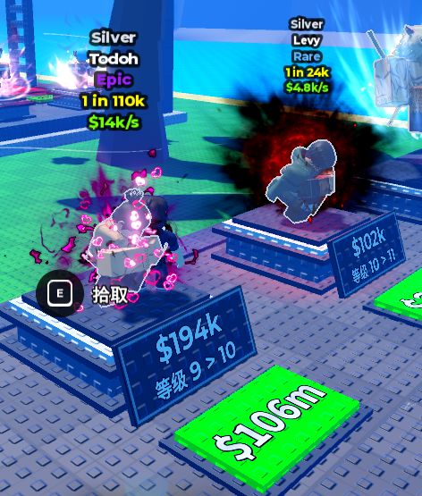

# 开发功能清单

更新日期：2026-11-01

按用户逐项提出的需求记录，不自行增加其他系统。本文件仅登记需求，不表示已实现或验收通过；涉及数值先使用临时配置。

---

## 1．初始剑、槽位收益、领钱与升级

- [ ] **验收完成**

**功能要求**

- 从资源商店找一把剑，具体款式没有要求。
- 新手玩家开局时，在自己基地的第一个槽位放置这把剑。
- 剑每秒产生收益。
- 槽位前方的绿色领钱区域显示当前可领取的金币数量，随收益积累更新；玩家靠近自己槽位的领钱区域后自动领取，不需要点击。
- 槽位提供升级牌子，点击后升级的是当前放在槽位上的这把剑，提高这把剑的每秒收益，不是升级槽位。
- 剑升级后，上方 HUD 的每秒收益，以及牌子上的等级、升级费用等信息同步更新。
- 展示参考用户提供的图片：武器上方信息、槽位前方的等级与升级牌子、地面的累计金额领钱区域。
- 沿用当前基地和槽位，不重新制作基地。

**参考图片**

**数值**

- 初始每秒收益、升级费用、等级对应收益等先填临时值。

**验收要点**

- 新玩家第一次进入时，第一个槽位有剑并开始积累收益。
- 领钱后相应金额计入玩家金币，该槽位已领取金额清零，不重复领取。
- 绿色领钱区域显示的数量与实际可领取金额一致，靠近后自动领取并更新显示，不能领取其他玩家的收益。
- 点击升级牌子后按临时配置扣费、提升当前这把剑的等级；剑上方 HUD 的每秒收益和牌子信息随之更新，槽位本身不升级；金币不足时不升级、不扣费。
- 重登或角色重新出生不重复赠送初始剑。

---

## 2．锻造区按钮、随机分配锻造台与离开

- [ ] **验收完成**

**功能要求**

- 玩家靠近现有锻造区时显示“锻造”按钮。
- 点击按钮后，从未被占用的锻造台中随机分配一个给玩家。
- 将玩家传送到分配的锻造台位置。
- 按钮变为“离开锻造台”，点击后离开并释放占用。
- 游戏按 8 人设计，使用现有 8 个锻造台。
- 本项只做分配、传送和离开，不增加锤击、品质抽取等打造流程。

**数值**

- 按钮显示距离、台位传送落点和离开落点先按现有场景设置临时值。

**验收要点**

- 不同玩家不会被分配到同一个已占用台位。
- 重复点击不会给同一玩家占用多个台位。
- 点击离开后回到锻造区安全位置，台位可再次分配。
- 玩家离服或角色死亡时释放占用，按钮状态与分配状态保持一致。

---

## 3．中心圆圈公共矿石刷新与挖取次数

- [ ] **验收完成**

**功能要求**

- 在当前世界中心圆圈范围内，按一定时间间隔刷新可挖取的石头。
- 主界面显示可挖取石头距离下一次刷新的倒计时。
- 石头为公共资源，所有玩家竞争挖取，不是个人独立资源。
- 挖取暂用靠近后点击按钮交互，每次有效交互扣除石头一次剩余挖取次数。
- 次数耗尽后石头消失，后续按刷新规则出现。
- 先不扩展复杂挖矿表现，记录的交互方式以按钮扣次数为准。

**配置表**

- 刷新间隔。
- 刷新数量。
- 石头的可挖取次数。
- 石头的刷新概率。
- 上述数值先填临时值，通过项目配置表维护。

**验收要点**

- 玩家看到同一批公共石头和相同的剩余次数。
- 主界面刷新倒计时与实际刷新时间一致，刷新后更新为下一轮倒计时。
- 多人同时抢同一块石头时，不会扣出负数或超过可挖次数。
- 次数耗尽后不能继续挖取，刷新遵循配置的间隔、数量和概率。

---

## 4．挖石获得矿石道具、火炉换剑

- [ ] **验收完成**

**功能要求**

- 玩家有效挖取第 3 项中的石头后，获得矿石。
- 矿石作为道具进入玩家背包。
- 玩家靠近现有火炉时，可以交互消耗矿石并换成剑。

**数值**

- 每次挖取获得的矿石数量、换一把剑需要的矿石数量先填临时值。

**验收要点**

- 有效挖取扣除一次石头次数，并给实际挖取者发放对应矿石，不给其他玩家重复发放。
- 火炉兑换成功时扣除对应矿石并获得剑；矿石不足时不扣物品、不发剑。
- 重复点击或多人同时操作不会复制矿石或剑。
